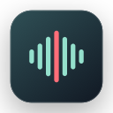

<p align="center">
  
</p>

<h1 align="center">🎙️ EchoBar</h1>

<p align="center"><strong>Graba con un clic el sonido que reproduce tu Mac.</strong><br>
Sin instalar controladores de audio virtuales.</p>

<p align="center"><strong>Unos 1,9 MB</strong> · App nativa en Swift · macOS 14.2+ · Código abierto con licencia MIT</p>

<p align="center">
  <a href="https://github.com/Adisonyao/EchoBar/releases"><strong>Descargar EchoBar</strong></a> ·
  <a href="#install">Guía de instalación</a> ·
  <a href="#project-structure">Estructura del proyecto</a>
</p>

[English](../../README.md) · [简体中文](README.zh-Hans.md) · [繁體中文](README.zh-Hant.md) · [日本語](README.ja.md) · [한국어](README.ko.md) · [العربية](README.ar.md) · [Français](README.fr.md) · [Русский](README.ru.md) · **Español** · [Deutsch](README.de.md) · [Português (Brasil)](README.pt-BR.md) · [Italiano](README.it.md) · [हिन्दी](README.hi.md)

<p align="center">
  
</p>

## ✨ Características principales

- **Nativa y ligera.** Desarrollada en Swift, captura el audio del sistema mediante Apple Core Audio. La versión Release universal ocupa unos 1,9 MB y no tiene dependencias de terceros.
- **Diseño sencillo.** Todos los controles están en una ventana pequeña. Puedes elegir dónde guardar las grabaciones y ajustar el formato WAV.
- **Protege tus grabaciones.** EchoBar escribe el audio durante la grabación y lo sincroniza periódicamente con el disco. Al cerrar la app normalmente, termina de guardar antes de salir.
- **Grabación local.** Solo captura el audio del sistema y no requiere acceso al micrófono. Funciona sin conexión y los archivos se quedan en tu Mac.

<a name="install"></a>

## 📥 Instalación

1. Ve a [GitHub Releases](https://github.com/Adisonyao/EchoBar/releases) y descarga EchoBar desde **Assets** en la última versión. Si descargas un archivo comprimido, descomprímelo primero.
2. Arrastra `EchoBar.app` a la carpeta **Aplicaciones (Applications)** y abre la app.

**Requisitos del sistema** · macOS 14.2 o posterior, en Mac con chip de Apple o procesador Intel.

## ❓ Preguntas frecuentes

<details>
<summary>¿Por qué macOS solicita permiso?</summary>

La primera vez que grabes, sigue el aviso de macOS para permitir la captura del audio del sistema. Así EchoBar puede acceder al sonido que reproduce tu Mac.

</details>

<details>
<summary>¿Puedo recuperar una grabación tras un fallo o un cierre forzado?</summary>

Al volver a abrir EchoBar, la app intenta recuperar el audio que ya se escribió en el disco. El audio que aún estaba en memoria puede perderse.

</details>

<a name="project-structure"></a>

## 📂 Estructura del proyecto

<details>
<summary>Mostrar la estructura del código y la documentación</summary>

```text
EchoBar/
├── EchoBar.xcodeproj/             # Proyecto de Xcode y esquema compartido
├── EchoBar/
│   ├── EchoBarApp.swift           # Punto de entrada, preferencias y estado de grabación
│   ├── RecorderView.swift         # Ventana de grabación y ajustes
│   ├── SystemAudioRecorder.swift  # Captura de audio del sistema y escritura WAV
│   ├── RecordingRecovery.swift    # Recuperación tras interrupciones
│   ├── AudioSpectrum.swift        # Espectro de audio en tiempo real
│   ├── Localizable.xcstrings     # Traducciones de la interfaz
│   └── Assets.xcassets/           # Icono y recursos de la interfaz
├── docs/
│   ├── assets/                    # Imágenes del README
│   └── readme/                    # README en otros idiomas
├── README.md                      # Página principal del proyecto
└── LICENSE                        # Licencia MIT
```

</details>

## 🛠️ Compilar desde el código fuente

Abre [EchoBar.xcodeproj](../../EchoBar.xcodeproj) en una versión de Xcode que incluya el **SDK de macOS 26 o posterior**. Selecciona **EchoBar** y **My Mac**, y pulsa **⌘R**.

Para generar una versión Release universal, ejecuta este comando desde la raíz del repositorio.

```sh
xcodebuild -project EchoBar.xcodeproj -scheme EchoBar -configuration Release \
  -destination 'generic/platform=macOS' -derivedDataPath DerivedData build
```

La app compilada se encuentra en `DerivedData/Build/Products/Release/EchoBar.app`.

## 📄 Licencia

[MIT](../../LICENSE)
