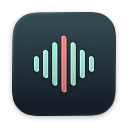

<p align="center">
  
</p>

<h1 align="center">🎙️ EchoBar</h1>

<p align="center"><strong>एक क्लिक में अपने Mac पर बज रही आवाज़ रिकॉर्ड करें।</strong><br>
वर्चुअल ऑडियो ड्राइवर इंस्टॉल करने की ज़रूरत नहीं।</p>

<p align="center"><strong>लगभग 2.8 MB</strong> · Swift में बना नेटिव ऐप · macOS 14.2+ · MIT लाइसेंस के तहत ओपन सोर्स</p>

<p align="center">
  <a href="https://github.com/Adisonyao/EchoBar/releases/latest/download/EchoBar-macOS.zip"><strong>EchoBar डाउनलोड करें</strong></a> ·
  <a href="#install">इंस्टॉल करने का तरीका</a> ·
  <a href="#project-structure">प्रोजेक्ट की संरचना</a>
</p>

[English](../../README.md) · [简体中文](README.zh-Hans.md) · [繁體中文](README.zh-Hant.md) · [日本語](README.ja.md) · [한국어](README.ko.md) · [العربية](README.ar.md) · [Français](README.fr.md) · [Русский](README.ru.md) · [Español](README.es.md) · [Deutsch](README.de.md) · [Português (Brasil)](README.pt-BR.md) · [Italiano](README.it.md) · **हिन्दी**

<p align="center">
  
</p>

## ✨ मुख्य खूबियाँ

- **छोटा और नेटिव।** Swift में बना EchoBar, Apple Core Audio से सिस्टम ऑडियो कैप्चर करता है। यूनिवर्सल Release ऐप का आकार लगभग 2.8 MB है और इसे किसी थर्ड-पार्टी लाइब्रेरी की ज़रूरत नहीं है।
- **सरल डिज़ाइन।** सारे कंट्रोल एक छोटी विंडो में हैं। आप रिकॉर्डिंग का फ़ोल्डर और WAV फ़ॉर्मैट बदल सकते हैं।
- **रिकॉर्डिंग सुरक्षित रखने को प्राथमिकता।** EchoBar रिकॉर्डिंग के दौरान ऑडियो फ़ाइल में लिखता रहता है और डेटा को नियमित रूप से डिस्क पर सिंक करता है। ऐप सामान्य तरीके से बंद करने पर पहले रिकॉर्डिंग सेव होती है।
- **लोकल रिकॉर्डिंग।** ऐप केवल सिस्टम ऑडियो रिकॉर्ड करता है, इसलिए माइक्रोफ़ोन की अनुमति नहीं चाहिए। रिकॉर्डिंग ऑफ़लाइन भी होती है और फ़ाइलें आपके Mac पर रहती हैं।

<a name="install"></a>

## 📥 इंस्टॉलेशन

1. [GitHub Releases](https://github.com/Adisonyao/EchoBar/releases) पर जाएँ और सबसे नए रिलीज़ के **Assets** सेक्शन से EchoBar डाउनलोड करें। अगर फ़ाइल कंप्रेस्ड है, तो पहले उसे एक्सट्रैक्ट करें।
2. `EchoBar.app` को **Applications (ऐप्लिकेशन)** फ़ोल्डर में खींचकर छोड़ें, फिर ऐप खोलें।

**सिस्टम की ज़रूरतें** · macOS 14.2 या नया संस्करण, Apple चिप और Intel प्रोसेसर वाले Mac पर।

## ❓ अक्सर पूछे जाने वाले सवाल

<details>
<summary>macOS अनुमति क्यों माँगता है?</summary>

पहली बार रिकॉर्ड करते समय macOS के निर्देश के अनुसार सिस्टम ऑडियो कैप्चर करने की अनुमति दें। इससे EchoBar आपके Mac पर बज रही आवाज़ कैप्चर कर सकता है।

</details>

<details>
<summary>ऐप क्रैश हो जाए या ज़बरदस्ती बंद करना पड़े, तो क्या रिकॉर्डिंग वापस मिल सकती है?</summary>

EchoBar दोबारा खोलने पर डिस्क पर पहले से लिखे गए ऑडियो को वापस पाने की कोशिश करता है। रुकावट के समय जो ऑडियो मेमोरी में था, वह खो सकता है।

</details>

<a name="project-structure"></a>

## 📂 प्रोजेक्ट की संरचना

<details>
<summary>सोर्स कोड और दस्तावेज़ों की संरचना देखें</summary>

```text
EchoBar/
├── EchoBar.xcodeproj/             # Xcode प्रोजेक्ट और साझा स्कीम
├── EchoBar/
│   ├── EchoBarApp.swift           # ऐप का प्रवेश बिंदु, प्राथमिकताएँ और रिकॉर्डिंग की स्थिति
│   ├── RecorderView.swift         # रिकॉर्डिंग विंडो और सेटिंग्स
│   ├── SystemAudioRecorder.swift  # सिस्टम ऑडियो कैप्चर और WAV में लिखना
│   ├── RecordingRecovery.swift    # रुकी हुई रिकॉर्डिंग की रिकवरी
│   ├── AudioSpectrum.swift        # लाइव ऑडियो स्पेक्ट्रम
│   ├── Localizable.xcstrings     # इंटरफ़ेस के अनुवाद
│   └── AppIcon.icon/              # ऐप का आइकन (Icon Composer)
├── docs/
│   ├── assets/                    # README की तस्वीरें
│   │   └── icon/echobar-icon-128.png
│   └── readme/                    # अलग-अलग भाषाओं में README
├── README.md                      # प्रोजेक्ट का होमपेज
└── LICENSE                        # MIT लाइसेंस
```

</details>

## 🛠️ सोर्स कोड से बिल्ड करें

**macOS 26 SDK या नया SDK** वाले Xcode में [EchoBar.xcodeproj](../../EchoBar.xcodeproj) खोलें। **EchoBar** और **My Mac** चुनें, फिर **⌘R** दबाएँ।

यूनिवर्सल Release बिल्ड बनाने के लिए रिपॉज़िटरी के मुख्य फ़ोल्डर से यह कमांड चलाएँ।

```sh
xcodebuild -project EchoBar.xcodeproj -scheme EchoBar -configuration Release \
  -destination 'generic/platform=macOS' -derivedDataPath DerivedData build
```

बिल्ड किया गया ऐप `DerivedData/Build/Products/Release/EchoBar.app` में मिलेगा।

## 📄 लाइसेंस

[MIT](../../LICENSE)
