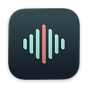

<p align="center">
  
</p>

<h1 align="center">🎙️ EchoBar</h1>

<p align="center"><strong>Grave com um clique o som que o Mac reproduz.</strong><br>
Sem instalar drivers de áudio virtuais.</p>

<p align="center"><strong>Cerca de 2,8 MB</strong> · App nativo em Swift · macOS 14.2+ · Código aberto sob a licença MIT</p>

<p align="center">
  <a href="https://github.com/Adisonyao/EchoBar/releases/latest/download/EchoBar-macOS.zip"><strong>Baixar EchoBar</strong></a> ·
  <a href="#install">Guia de instalação</a> ·
  <a href="#project-structure">Estrutura do projeto</a>
</p>

[English](../../README.md) · [简体中文](README.zh-Hans.md) · [繁體中文](README.zh-Hant.md) · [日本語](README.ja.md) · [한국어](README.ko.md) · [العربية](README.ar.md) · [Français](README.fr.md) · [Русский](README.ru.md) · [Español](README.es.md) · [Deutsch](README.de.md) · **Português (Brasil)** · [Italiano](README.it.md) · [हिन्दी](README.hi.md)

<p align="center">
  
</p>

## ✨ Destaques

- **Nativo e leve.** Desenvolvido em Swift, o EchoBar captura o áudio do sistema com o Apple Core Audio. A versão Release universal ocupa cerca de 2,8 MB e não tem dependências de terceiros.
- **Interface simples.** Todos os controles ficam em uma janela pequena. Você pode escolher a pasta de destino e ajustar o formato WAV.
- **Preservação das gravações.** O EchoBar grava os dados continuamente e os sincroniza com o disco em intervalos regulares. Ao encerrar o app normalmente, ele termina de salvar antes de fechar.
- **Gravação local.** Captura apenas o áudio do sistema, sem acesso ao microfone. Funciona sem internet e os arquivos ficam no Mac.

<a name="install"></a>

## 📥 Instalação

1. Acesse [GitHub Releases](https://github.com/Adisonyao/EchoBar/releases) e baixe o EchoBar na seção **Assets** da versão mais recente. Se o arquivo estiver compactado, extraia-o primeiro.
2. Arraste `EchoBar.app` para a pasta **Aplicativos (Applications)** e abra o app.

**Requisitos do sistema** · macOS 14.2 ou posterior, em Macs com chip da Apple ou processador Intel.

## ❓ Perguntas frequentes

<details>
<summary>Por que o macOS pede permissão?</summary>

Na primeira gravação, siga o aviso do macOS para permitir a captura do áudio do sistema. Isso dá ao EchoBar acesso ao som que o Mac está reproduzindo.

</details>

<details>
<summary>É possível recuperar uma gravação após uma falha ou encerramento forçado?</summary>

Ao reabrir, o EchoBar tenta recuperar o áudio que já foi gravado no disco. O áudio que ainda estava na memória quando houve a interrupção pode ser perdido.

</details>

<a name="project-structure"></a>

## 📂 Estrutura do projeto

<details>
<summary>Mostrar a estrutura do código e da documentação</summary>

```text
EchoBar/
├── EchoBar.xcodeproj/             # Projeto Xcode e esquema compartilhado
├── EchoBar/
│   ├── EchoBarApp.swift           # Ponto de entrada, preferências e estado da gravação
│   ├── RecorderView.swift         # Janela de gravação e ajustes
│   ├── SystemAudioRecorder.swift  # Captura do áudio do sistema e gravação em WAV
│   ├── RecordingRecovery.swift    # Recuperação de gravações interrompidas
│   ├── AudioSpectrum.swift        # Espectro de áudio em tempo real
│   ├── Localizable.xcstrings     # Traduções da interface
│   └── AppIcon.icon/              # Ícone do app (Icon Composer)
├── docs/
│   ├── assets/                    # Imagens do README
│   │   └── icon/echobar-icon-128.png
│   └── readme/                    # READMEs traduzidos
├── README.md                      # Página inicial do projeto
└── LICENSE                        # Licença MIT
```

</details>

## 🛠️ Compilar a partir do código-fonte

Abra [EchoBar.xcodeproj](../../EchoBar.xcodeproj) no Xcode com o **SDK do macOS 26 ou posterior**. Selecione **EchoBar** e **My Mac** e pressione **⌘R**.

Para compilar a versão Release universal, execute este comando na raiz do repositório.

```sh
xcodebuild -project EchoBar.xcodeproj -scheme EchoBar -configuration Release \
  -destination 'generic/platform=macOS' -derivedDataPath DerivedData build
```

O app compilado fica em `DerivedData/Build/Products/Release/EchoBar.app`.

## 📄 Licença

[MIT](../../LICENSE)
