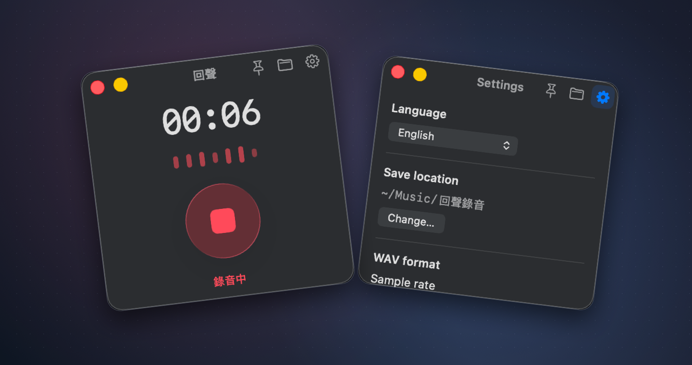

# EchoBar

[English](../../README.md) · **简体中文** · [繁體中文](README.zh-Hant.md) · [日本語](README.ja.md) · [한국어](README.ko.md) · [العربية](README.ar.md) · [Français](README.fr.md) · [Русский](README.ru.md) · [Español](README.es.md) · [Deutsch](README.de.md) · [Português (Brasil)](README.pt-BR.md) · [Italiano](README.it.md) · [हिन्दी](README.hi.md)

EchoBar 是一款小巧的原生 macOS 录音工具，用来录制应用播放的声音。点一下开始，再点一下保存为 WAV。



## 主要功能

- **录制系统音频。** 通过 Apple Core Audio 捕获应用播放的声音。录音时仍可正常听到声音，无需麦克风权限。
- **小窗口，操作直接。** 七段实时频谱从左到右对应低频到高频。超过一小时，计时器切换为时、分、秒。点击圆形录音键或按 **⌘R**。
- **可控制文件体积。** PCM WAV 可跟随源采样率，或选 16、24、32、44.1、48 kHz，位深可选 8、16、24 bit。设置页显示每小时的预估大小。较低的规格会降低保真度，同时缩小文件。
- **适合自己的使用方式。** 可将窗口置顶于普通窗口上方，在访达打开录音目录，并在同一窗口更改目录、格式和关窗行为。设置保存在本机，重开后仍有效。
- **数据留在本机。** 录音、偏好和恢复信息都保存在 Mac 上。没有遥测、上传功能或第三方依赖。
- **13 种界面语言。** 可在设置里选择或跟随系统。阿拉伯语设置支持从右到左排版。
- **操作有反馈。** 设置页在同一窗口内滑动切换。保存后可点击状态在访达中查看文件，也可允许 macOS 通知接收保存提示。

[录音界面截图](../../docs/assets/recorder.png) · [设置页截图](../../docs/assets/settings.png)

## 开始录音

1. 构建并运行 EchoBar，在 macOS 提示时允许录制系统音频。
2. 在其他应用播放声音，点击红色按钮开始，再点一次保存。默认目录为 `~/Music/回聲錄音/`。
3. 用文件夹图标打开保存位置，用齿轮更改设置。录音设置在下一次录音时生效。

## 恢复与兼容性

正常退出时，EchoBar 会先保存录音。崩溃或强制退出后，重新打开 App 可恢复已写入磁盘的音频。突然中断时，仍在内存中的录音尾端可能丢失。

需要 **macOS 14.2 或以上**及兼容的 Intel 或 Apple 芯片 Mac。macOS 26 起使用原生 Liquid Glass，较早的系统使用标准系统材质。构建包含两种架构，实际运行在 Apple 芯片 Mac 上验证。

## 从源码构建

使用带 macOS 26 SDK 或更新版本的 Xcode 打开 [EchoBar.xcodeproj](../../EchoBar.xcodeproj)，选中 **EchoBar** scheme 和 **My Mac**，按 **⌘R**。通用 Release 构建：

```sh
xcodebuild -project EchoBar.xcodeproj -scheme EchoBar -configuration Release \
  -destination 'generic/platform=macOS' -derivedDataPath DerivedData build
```

产物位于 `DerivedData/Build/Products/Release/EchoBar.app`，本机构建使用临时签名。

## 授权

[MIT](../../LICENSE)。
